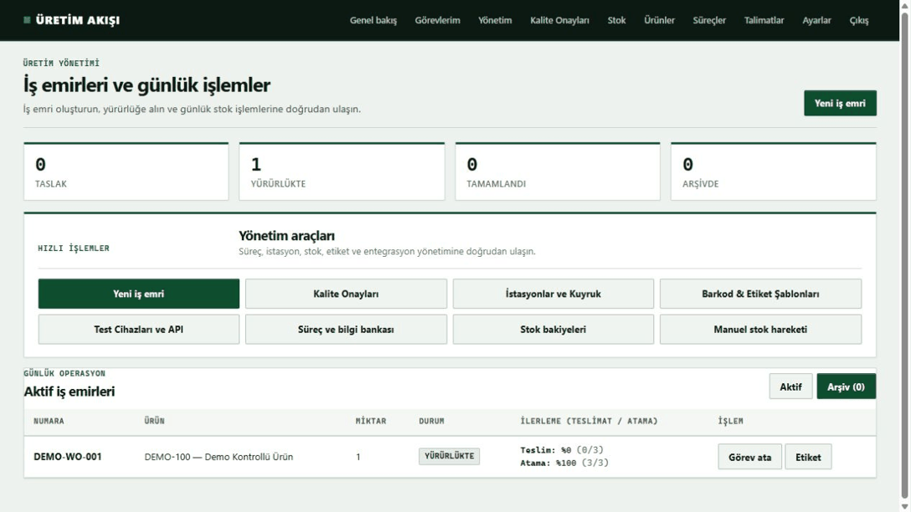
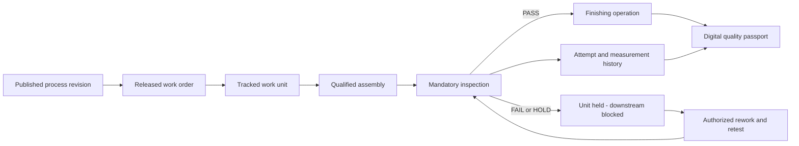
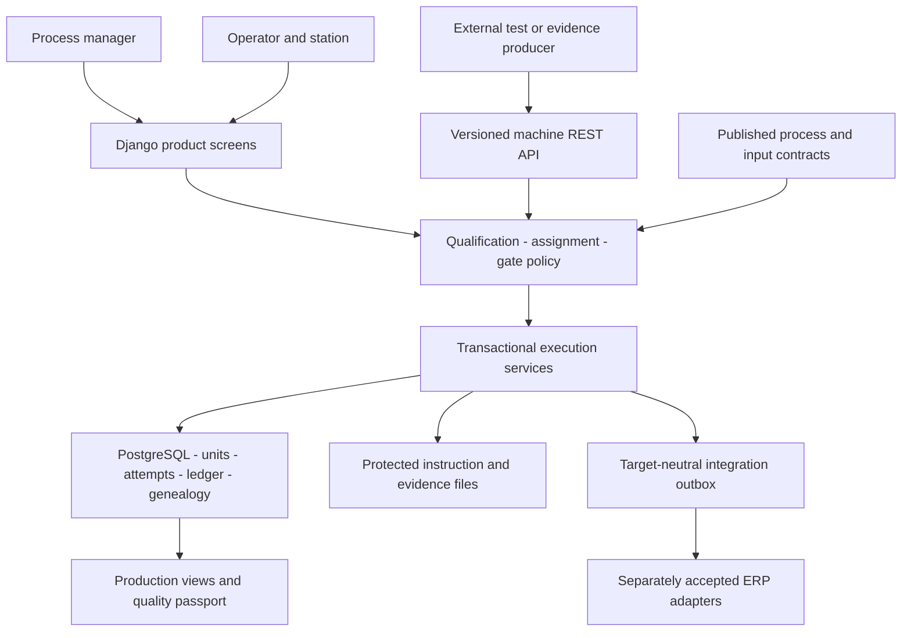
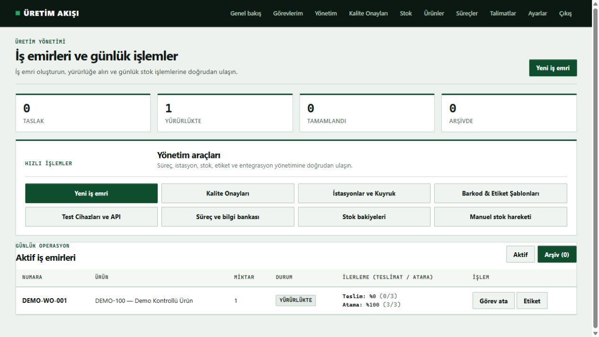
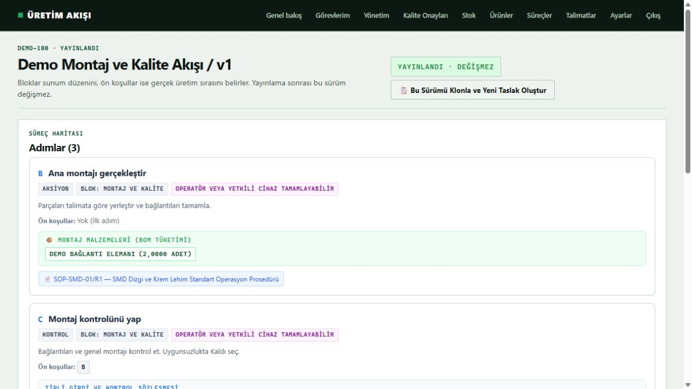
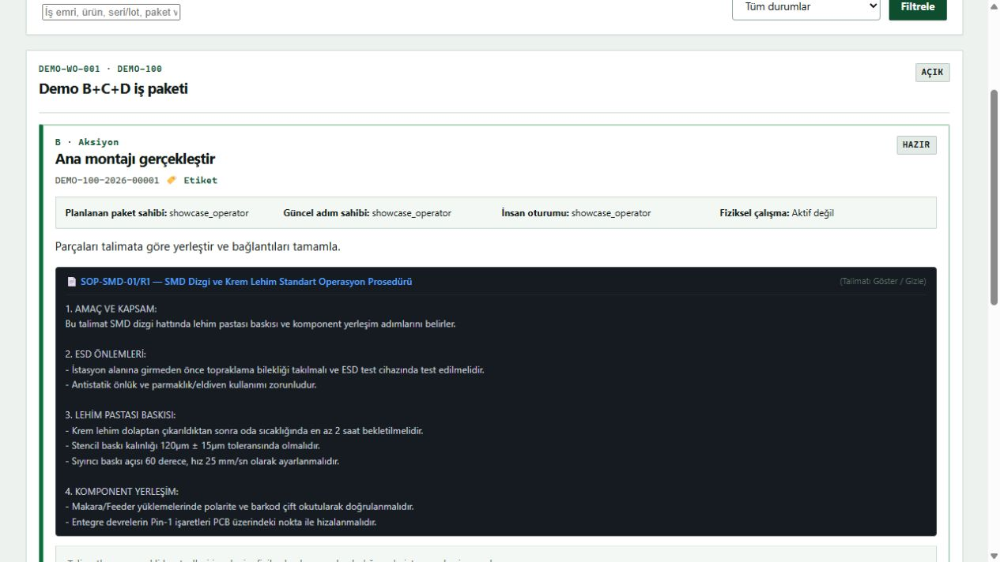
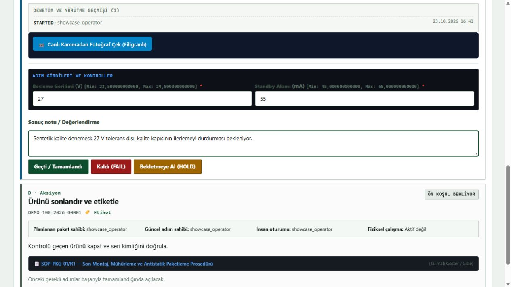
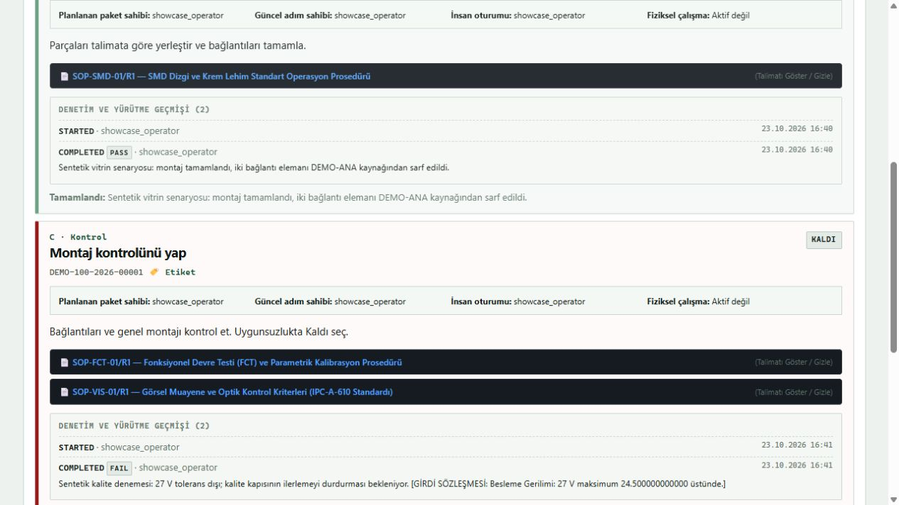
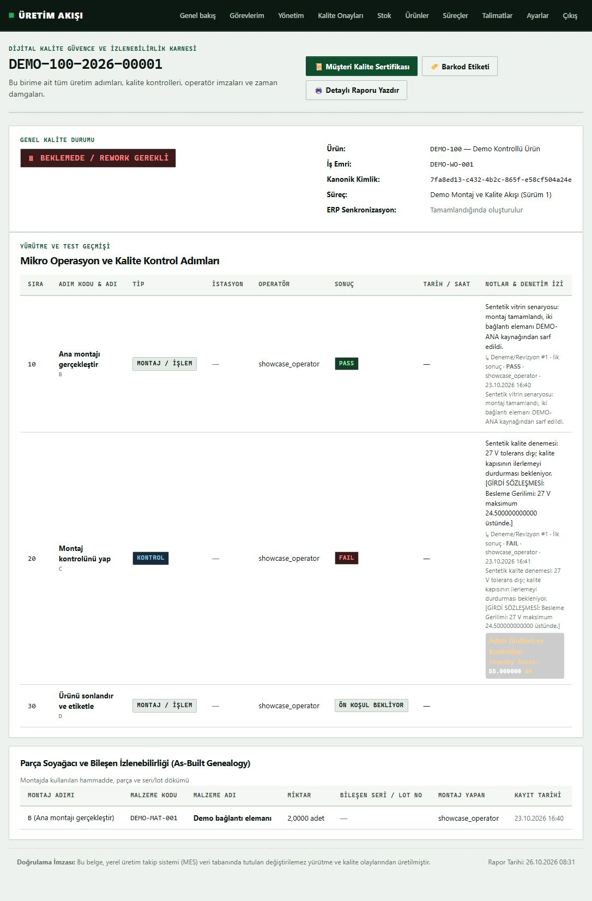

# Production Execution

**Configurable production workflows, mandatory quality gates and traceable execution evidence.**

Production Execution is a manufacturing work-execution product being prepared for
local installation. Administrators define the process; operators execute the
required steps; the system governs qualification, dependencies, measurements,
material consumption and quality decisions against each tracked work unit.

This repository is the public engineering case study. It contains architecture,
synthetic product screenshots and inspectable evidence. The application source,
customer data and commercial deployment materials remain private.

*Six real browser stills from an isolated synthetic run. This is a screenshot
sequence, not a continuous video; full captures and raw state are linked below.*

## Contents

- [The Problem](#the-problem)
- [Product Capabilities](#product-capabilities)
- [A Production Walkthrough](#a-production-walkthrough)
- [Architecture](#architecture)
- [Engineering Decisions](#engineering-decisions)
- [Screens And Walkthrough](#screens-and-walkthrough)
- [Evidence And Verification](#evidence-and-verification)
- [Delivery And Current Boundaries](#delivery-and-current-boundaries)
- [Türkçe Özet](#turkce-ozet)
- [Author](#author)

## The Problem

A completed checkbox does not establish that the correct person followed the
correct process revision, supplied the required measurements and passed the
quality gate. A spreadsheet or a status board can report progress while allowing
those conditions to drift apart.

The product connects the process definition to what may actually happen next.
A failed mandatory control holds the unit and prevents downstream work. Retesting
and authorized correction preserve the earlier result rather than rewriting it
into an apparently clean history.

The target is a configurable lightweight MES/work-execution, SOP and quality-gate
system. The local workflow can operate without an ERP. ERP ownership and adapters
are separate integration boundaries; accounting, advanced planning and a full
quality-management suite are outside this product's current scope.

## Product Capabilities

| Area | Product behavior |
| --- | --- |
| Process authoring | Products, action/control steps, prerequisites and immutable published workflow revisions. |
| Controlled instructions | Revisioned knowledge documents and step-specific SOP references visible during work. |
| Work identity | Released orders create serial-, lot- or quantity-bound work units and their execution state. |
| Qualified execution | Qualification, assignment, role and separation-of-duties rules govern who may perform each operation. |
| Quality gates | Required steps and failed/held controls determine whether downstream operations are available. |
| Typed measurements | Decimal values, units, tolerances, checkboxes, OK/NOK, choices, text, barcode and evidence-file contracts. |
| Rework and correction | Retest/correction flows retain previous attempts and invalidate affected downstream results when required. |
| Materials and genealogy | Step-level BOM, exact source lot/serial consumption and as-built component relationships. |
| Inventory | Local immutable movement ledger and validated Excel import; an explicit authority boundary for ERP-owned stock. |
| Device integration | Authenticated versioned REST contracts for verify, interlocking and evidence submission, including idempotent retries. |
| Production views | Operator tasks, work packages, station activity, management overview and a digital quality passport. |
| Delivery | On-premises appliance topology, offline entitlement verification, health/operational tooling and recovery procedures. |

These capabilities have different evidence levels. The walkthrough below proves a
bounded synthetic browser path. The verification record distinguishes automated
checks from the appliance and field checks that remain outside this package.
A screenshot is not a substitute for field acceptance.

## A Production Walkthrough

The case study uses a fresh synthetic assembly order. It never reads the
maintainer's existing operational database or private media.

1. Bootstrap a synthetic published revision, released order and qualified assignment.
2. Inspect the process, dependencies and measurement definitions as a manager.
3. Open the operator task and read the linked controlled instruction.
4. Complete assembly with its required material/step data.
5. Request PASS with a deliberately invalid 27 V measurement against a 23.5–24.5 V contract.
6. Observe the server recording FAIL, holding the unit and keeping finishing blocked.
7. Follow the recorded attempt history and the unit's quality passport.

The recorded outcomes and any unfinished steps are listed in
[walkthrough.json](evidence/walkthrough.json). The evidence describes what was
actually observed; it does not silently turn planned steps into successful results.

The recording ends at the held unit. Retest and final completion are not part of
this browser run. At this checkpoint the rejected voltage appears in the failure
note; the accepted current is a structured measurement. This is not proof of
complete structured retention of rejected measurements.

## Architecture

| Component | Responsibility |
| --- | --- |
| Django application | Server-rendered product screens, authenticated commands and business services. |
| Workflow definitions | Controlled revisions, step dependencies, typed input definitions and knowledge references. |
| Execution services | Qualification, assignment, gate transitions, retest/correction and material issue validation. |
| PostgreSQL | Supported multi-user appliance database and transactional ownership boundaries. |
| SQLite | Local development and the isolated screenshot fixture; it does not prove PostgreSQL concurrency. |
| Protected media | Application-authorized local files, checked file types/sizes and recorded hashes. |
| Machine API | Versioned producer contracts, authorization, replay handling and state-safe submissions. |
| Appliance services | Caddy ingress, application workers, PostgreSQL and shared broker/cache/background roles. |

External cameras, PLC gateways or analysis systems can submit typed evidence. The
MES owns the accepted production state and quality policy. An external result does
not bypass those rules, and the product does not claim an embedded autonomous
vision-training platform.

## Engineering Decisions

| Decision | Purpose | Boundary / tradeoff |
| --- | --- | --- |
| Immutable published processes | Keep work attached to the revision that authorized it. | Changes create a new draft/revision instead of silently altering released work. |
| Server-owned execution policy | Apply rules across human and machine entry points. | UI controls alone cannot authorize a transition. |
| Explicit quality dependencies | Prevent progress through a failed required gate. | Rework needs an authorized state transition rather than a status overwrite. |
| Preserved attempts | Retain initial failures, retests and authorized corrections. | The current projection and the historical record have distinct roles. |
| Typed evidence | Evaluate concrete measurements and requirements. | Raw telemetry is not automatically a quality verdict. |
| Material genealogy | Connect consumption to the actual unit and source identity. | Historical imports without provable links require reconciliation. |
| Local operation first | Keep production execution usable without an ERP connection. | Every external adapter still needs its own environment-specific acceptance. |
| Offline signed entitlement | Verify commercial permissions without distributing signing secrets. | Licensing is separate from workflow correctness and customer acceptance. |

## Screens And Walkthrough

### Product Management

### Controlled Process And Instructions

### Quality And Traceability

## Evidence And Verification

| File | What it establishes |
| --- | --- |
| [walkthrough.json](evidence/walkthrough.json) | Synthetic scenario, observed actions and remaining boundaries. |
| [production-state.json](evidence/production-state.json) | Allowlisted business-state snapshot from the fixture-owned database. |
| [verification.json](evidence/verification.json) | Actual verification commands, outcomes and checkpoint information. |
| [verification-output.txt](evidence/verification-output.txt) | Selected real verification output; private paths and expected refusal-case logs omitted. |
| [manifest.json](evidence/manifest.json) | SHA-256 hashes for the public files, excluding itself. |

Evidence contains synthetic data only. No database backup, user password hashes,
customer recipe, license document, private endpoint or signing material is shared.
Hashes establish consistency of the published bytes, not independent certification.

## Delivery And Current Boundaries

The intended delivery is an on-premises local installation, with a Linux appliance
reference topology. The maintainer reports successful dogfood against the existing
local database. This case study adds a separately recorded synthetic walkthrough.
Field validation and commissioning are the next proof stage.

- Formal release acceptance, physical appliance/LAN checks and authorized field
  operation are distinct from local browser success.
- The walkthrough does not benchmark concurrent factory workload or establish
  recovery times, camera provenance or live hardware reliability.
- Individual ERP adapters require their own authorized acceptance. No blanket ERP
  compatibility, automatic write-back or vendor certification is claimed.
- File delivery, storage capacity and backup/restore have explicit supported
  boundaries; a screenshot does not establish operating limits.
- Quantity-tracked execution can represent an aggregate rather than one physical
  identity for every individual piece.
- Full QMS, advanced planning, arbitrary BPMN and hosted multi-tenant SaaS are
  outside the current product scope.

---

# Türkçe Özet

## Ürün ve Amaç

**Production Execution**, üretim işlerini zorunlu işlem ve kalite kontrolleriyle
yürüten, yapılandırılabilir bir üretim takip ürünüdür. Yönetici süreci ve gerekli
yetkinlikleri tanımlar; operatör yayımlanmış talimata göre çalışır. Seri, lot veya
iş birimi; işlem, ölçüm, malzeme ve kalite geçmişiyle birlikte izlenir.

## Öne Çıkan Mühendislik

Başarısız zorunlu kalite kapısı sonraki işi durdurur. Yeniden test ve yetkili
düzeltme önceki başarısız sonucu silmez. Süreç revizyonları, operatör yetkinliği,
cihaz kanıtları, malzeme soy ağacı ve kalite pasaportu aynı yürütme sınırına bağlanır.
Yerel çalışma için ERP zorunlu değildir; gerçek ERP adaptörleri ayrı kabul ister.

## Mevcut Aşama ve Vitrin

Ürün yerel dogfood aşamasında kullanılmıştır; saha doğrulaması ve devreye alma
ayrı kanıt aşamasıdır. Bu vitrin için mevcut müşteri veritabanından bağımsız,
sentetik bir kurulum kullanılır. Ekranlar gerçek uygulamadan alınır; gözlenen
sonuçlar ve doğrulama sınırları yukarıdaki kanıtlarda açıktır.

Uygulama kaynağı ve ticari dağıtım özel kalır. Bu repo mimariyi ve ürünü görünür
kılar; kurulum paketi veya kaynak kod dağıtımı içermez.

---

## Author

**Muhammet Işık**

